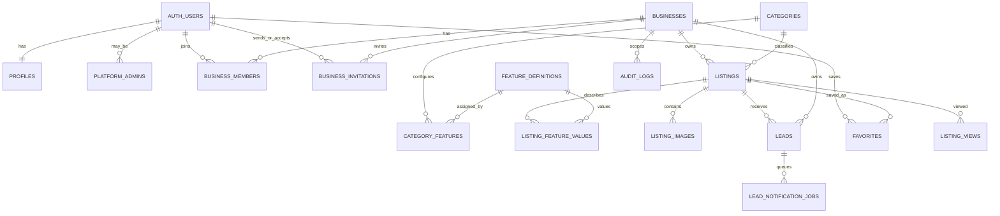

# Studiohut Database

## Overview

PostgreSQL in Supabase is the source of truth. Auth identities remain in `auth.users`; all application tables live in `public`. UUIDs are generated in PostgreSQL. Time values are `timestamptz` in UTC, and mutable records use an `updated_at` trigger.

## Relationships



## Tables

| Table                    | Purpose                                                     | Important constraints                                                  |
| ------------------------ | ----------------------------------------------------------- | ---------------------------------------------------------------------- |
| `profiles`               | Application profile for an Auth user                        | 1:1 with `auth.users`; `tr`/`en` locale                                |
| `platform_admins`        | Secure platform-wide administrator allowlist                | user PK; not stored in editable metadata                               |
| `businesses`             | Organization that owns studios                              | unique SEO slug; immutable creator reference                           |
| `business_members`       | User/business many-to-many membership                       | composite PK; owner/manager/editor enum; last owner protected          |
| `business_invitations`   | Expiring email-bound business membership invitations        | hashed unique token; one active invite per business/email              |
| `categories`             | Localized, ordered marketplace category                     | unique slug; active flag                                               |
| `feature_definitions`    | Typed dynamic field definition                              | unique key; type-specific options shape                                |
| `category_features`      | Assignment and display/filter configuration                 | composite PK; unique order within category                             |
| `listings`               | Studio/space record                                         | unique slug per business; review-state constraints; paired coordinates |
| `listing_feature_values` | One typed value for a listing feature                       | composite PK; exactly one value column; validation trigger             |
| `listing_images`         | Storage metadata and image ordering                         | unique path/order; one partial-indexed cover per listing               |
| `leads`                  | Inbound inquiry and attribution                             | listing/business composite FK prevents ownership spoofing              |
| `lead_rate_limits`       | Durable public-inquiry abuse windows keyed by a server HMAC | private 64-character hash PK; positive counters                        |
| `lead_notification_jobs` | Retryable business-email delivery outbox                    | unique lead/recipient; constrained state and sent timestamp            |
| `review_notification_jobs` | Private platform-admin review email outbox | listing/submission/admin uniqueness; claim leases and bounded retries |
| `favorites`              | User-saved listings                                         | composite PK                                                           |
| `listing_views`          | Minimal analytics event                                     | requires user or privacy-preserving session hash                       |
| `audit_logs`             | Append-only privileged activity history                     | optional actor/business after deletion                                 |

## Dynamic feature storage

`feature_type` supports `boolean`, `number`, `select`, `multi_select`, and `text`. A definition has optional JSON choices and JSON validation metadata. A listing may store only features assigned to its category. `listing_feature_values` uses typed columns:

- boolean → `value_boolean`
- number → `value_number`
- select/text → `value_text`
- multi-select → `value_json` as a JSON array

The `exactly_one_feature_value` check prevents ambiguous rows. `validate_listing_feature_value` verifies category assignment, correct column/type, allowed choices, numeric min/max, and text length. A trigger applies it on every insert and update, including writes outside the Next.js app.

## Listing workflow

The enum is `draft → pending_review → published|rejected`. Business members may create only drafts and may mutate listing fields, feature values, image metadata, or Storage objects only while a listing is `draft` or `rejected`; a listing's category is immutable after creation. `submit_listing_for_review` locks the listing, rechecks membership and all completeness requirements, and changes status in one transaction. The review trigger reserves publish/reject transitions for platform admins, sets `published_at`, and requires a rejection reason. The `review_listing` RPC rechecks admin status, locks the pending listing, changes its state, and writes an `audit_logs` before/after record atomically. `reopen_listing_for_editing` lets an authorized member withdraw a pending listing or unpublish a published listing back to draft and records that transition atomically. Published rows are the only listings visible to anonymous users. Business members may continue to see their own non-public listings.

## RLS and privileges

RLS is enabled on every public table. Grants allow a SQL operation to reach RLS; policies then decide which rows are visible.

| Data                            | Anonymous        | Authenticated customer | Business member                     | Platform admin     |
| ------------------------------- | ---------------- | ---------------------- | ----------------------------------- | ------------------ |
| active categories/features      | read             | read                   | read                                | full management    |
| published listings/images       | read             | read                   | read                                | full review access |
| draft/pending/rejected listings | none             | none                   | own business                        | all                |
| profiles                        | none             | self                   | self                                | read all           |
| memberships                     | none             | own                    | own/managed business                | all                |
| leads                           | no direct access | no direct access       | owner/manager of recipient business | all                |
| favorites                       | none             | own rows               | own rows                            | policy-bound       |
| analytics/audit                 | none             | none                   | owner/manager, own business         | all                |

`is_platform_admin`, `has_business_role`, and `can_read_listing` are `security definer` helpers with fixed search paths. Execute privileges are explicitly revoked and re-granted only to the roles that need them. Business owners are created atomically with `create_business_with_owner`; listing decisions and their audit records are committed atomically with `review_listing`; a trigger prevents deleting or demoting the last owner. Invitation rows have no direct browser table privileges. Team RPCs expose member email/name only to owners and managers, restrict invitation and membership mutation to owners, compare the accepting Auth email with the invitation email, and audit every lifecycle change.

Anonymous callers may execute `create_public_lead`, but they cannot insert into or read `leads`, rate-limit records, or notification jobs directly. The RPC validates input again in PostgreSQL, resolves only a published listing, derives its business, enforces the durable abuse and duplicate windows, and queues confirmed owner/manager recipients in the same transaction. `claim_lead_notification_jobs` is service-role-only and uses row locking for concurrent workers. Authenticated users cannot update `leads` directly; `update_business_lead_status` permits only owners/managers and writes the audit record atomically.

Direct `listing_views` mutation is revoked. Anonymous and authenticated visitors may execute `record_listing_view`, which accepts only published listings, requires a 64-character HMAC session hash, and suppresses duplicates for 30 minutes. No raw IP address or browser fingerprint is stored. `get_business_analytics` exposes bounded 7–90 day aggregates only to owners and managers of the requested business.

`purge_expired_operational_data` is executable only by `service_role`. Its parameters are bounded in SQL and it removes only expired listing views, successfully sent notification jobs, and stale rate-limit counters. Customer leads, failed delivery evidence, and audit records require an explicit reviewed retention decision and are not automatically deleted.

## Storage

The `listing-images` bucket is private so unpublished object URLs cannot bypass RLS. Published images are delivered through authenticated Storage reads or short-lived signed/transform URLs generated by the server. Accepted MIME types are JPEG, PNG, WebP, and AVIF; maximum object size is 10 MiB. Write policies parse the object path, verify that the listing belongs to that business, and require an owner, manager, or editor membership. Metadata rows are protected independently with table RLS.

## Index strategy

- partial public search index on category/location/publication time for published listings;
- business/status/update index for dashboard queries;
- type-specific feature indexes for boolean, numeric, and text filters;
- ordered image index and unique cover partial index;
- business/status and listing/time lead indexes;
- lead rate-limit maintenance and notification dequeue indexes;
- time-first retention indexes for listing views and sent notification jobs;
- listing/time views index;
- business/time and entity/time audit indexes.

Search-specific trigram or full-text indexes will be added only after Phase 2 query shapes are measured.

## Migrations and generated types

Migrations are ordered under `supabase/migrations`. `supabase/seed.sql` contains explicit demo configuration only and is never imported by production code. `src/lib/supabase/database.types.ts` provides checked-in compile-time types; after applying migrations to a project it should be regenerated from the resulting schema and committed:

```bash
npx supabase gen types typescript --local > /tmp/database.types.ts
```

Review the generated diff before replacing the checked-in type file.
